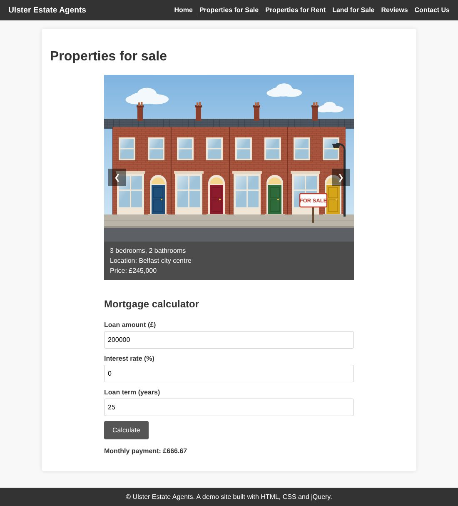

# Ulster Estate Agents

A multi-page website for a fictional estate agent in Northern Ireland, built with HTML, CSS and jQuery.



**Live demo:** _add your GitHub Pages link here_

## Features

- **Property, rental and land listings** shown as slideshows with next and previous buttons and auto-advance
- **Mortgage calculator** that validates its input and handles 0% interest
- **Reviews** that visitors can add and delete, saved in the browser with `localStorage`
- **Contact form** that checks every field and lists any problems before sending
- **Agent slideshow** and a property video tour on the home page
- Works on phones as well as desktops

## Running it

There's nothing to build or install. Open `index.html` in a browser, or serve the folder:

```bash
python3 -m http.server
```

Then go to http://localhost:8000.

## Project structure

```
index.html                  Home: agents slideshow and video tour
properties-for-sale.html    Houses for sale and the mortgage calculator
properties-for-rent.html    Rental listings
land-for-sale.html          Land listings
reviews.html                Add and view reviews
contact.html                Contact form
css/styles.css              All styles
js/script.js                Slideshows, forms, reviews and calculator
img/                        Listing photos, agent photos and video
```

## Notes

- User input in reviews is inserted with jQuery's `.text()`, so any HTML typed into a review is shown as text rather than run.
- The contact form has no back end; it validates the input and shows a confirmation.

## Credits

- Listing pictures and agent portraits are original illustrations made for this project.
- House tour video from [Pexels](https://www.pexels.com/videos/), free to use under the Pexels licence.
